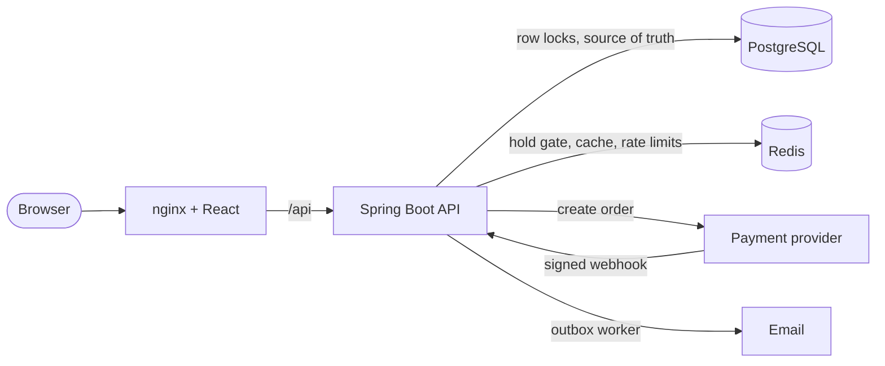
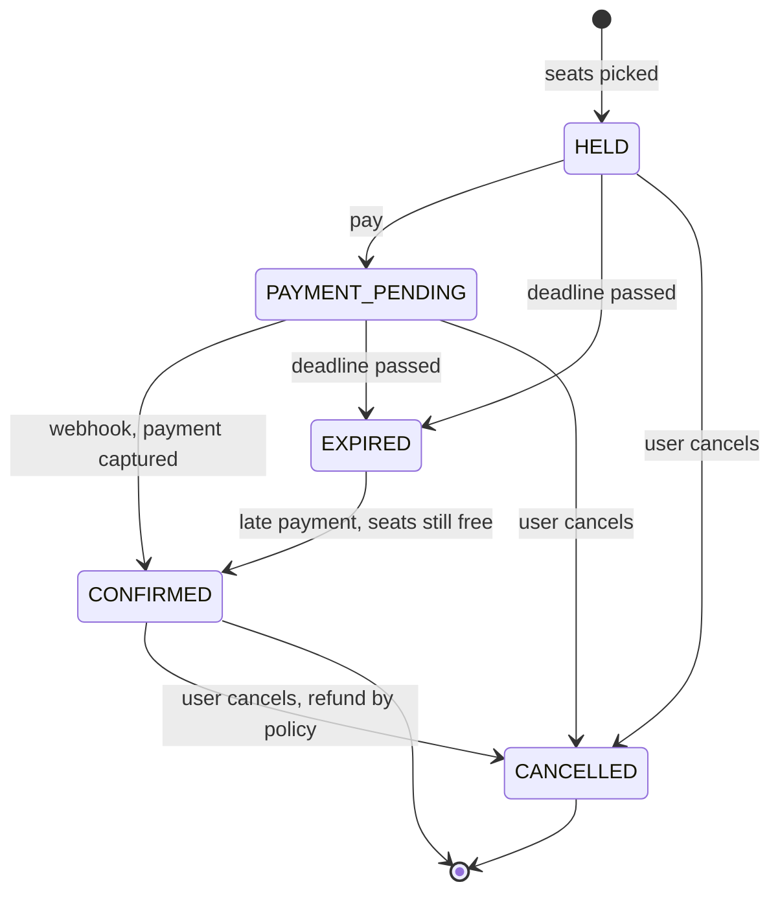

<div align="center">

# 🎟️ SeatRush

**A ticket booking platform that stays correct when everyone clicks "Book" at the same second.**

[](https://github.com/MrTestBud/SeatRush/actions/workflows/ci.yml)
[](https://github.com/MrTestBud/SeatRush/releases)


[Quick start](#-quick-start) · [How it works](#-how-double-booking-is-prevented) · [API](#-api) · [Releases](#-releases) · [Roadmap](#-roadmap)

</div>

---

Selling the last seat twice is the classic booking bug. SeatRush is built around not having it.

> **200 users hit the same seat at the same instant. Exactly one wins. 199 get a clean `409`. The database never holds two bookings for one seat.**
> That is not a claim, it is a test that runs on every build.

```
[PESSIMISTIC]              200 users, 1 seat: 1 won, 199 lost in 155 ms
[OPTIMISTIC]               200 users, 1 seat: 1 won, 199 lost in  74 ms
[REDIS GATE + PESSIMISTIC] 200 users, 1 seat: 1 won, 199 lost in  18 ms
```

## ✨ Features

| | |
|---|---|
| 🔒 **No double booking** | Two interchangeable locking strategies (pessimistic row locks, optimistic versioning), both proven under a 200-thread race |
| ⚡ **Redis hold gate** | Losers of a seat race are turned away in memory, before they ever open a database transaction |
| ⏱️ **Timed seat holds** | Picked seats are reserved for 5 minutes with a live countdown, then released automatically |
| 💳 **Payments done properly** | Signed, idempotent webhooks. Duplicate deliveries are no-ops. A payment that lands after the hold expired is honoured if the seats are free, flagged for refund if not |
| 🔁 **Idempotent requests** | A double click or a retried request returns the same booking instead of creating two |
| 📬 **Reliable emails** | Transactional outbox: a confirmation email exists if and only if the booking committed |
| 🔎 **Search** | PostgreSQL full-text search with relevance ranking, cached in Redis |
| 🛡️ **Rate limiting** | Per-IP on login, per-user on seat holds |
| 📡 **Real-time seat map** | Seats change colour the moment someone else holds, books or releases them (Server-Sent Events, fanned out across instances over Redis) |
| 🚦 **Virtual waiting room** | High-demand shows put buyers in a fair first-come-first-served queue and let them in a few at a time |
| 📱 **QR e-tickets and check-in** | Every confirmed booking gets a signed QR ticket; organizers scan or type it at the door, and it admits once |
| 💸 **Cancellation and automatic refunds** | Cancel a paid booking for a full or partial refund depending on how close the show is; refunds are issued by a background worker |
| 🏷️ **Coupons and demand pricing** | Organizer-defined discount codes with usage caps, and optional pricing that rises as a show fills up |
| 💺 **Flexible venues** | VIP, Premium and Regular tiers priced per show, with aisles in the seat map |
| ⭐ **Reviews** | Ratings and reviews, only from people who actually attended |
| 🔑 **Account emails** | Email verification and password reset with single-use, expiring links |
| 🎭 **Host console** | Venues, events, posters, shows, discount codes, and a live dashboard of seats sold, revenue and check-ins |
| 📈 **Observability** | Prometheus metrics and a ready-made Grafana dashboard for hold latency, conflict rate and payments |
| 🖥️ **Full web app** | React UI: browse and filter by category, search, book, pay, manage bookings, host events |

## 🚀 Quick start

You need [Docker](https://www.docker.com/products/docker-desktop/). That's it.

```bash
git clone https://github.com/MrTestBud/SeatRush.git
cd SeatRush
docker compose up -d --build
```

| | |
|---|---|
| App | http://localhost:3000 |
| API | http://localhost:8080 |
| Swagger UI | http://localhost:8080/swagger-ui/index.html |

**Try the whole flow in two minutes:**

1. Register and choose **Host events**.
2. Open **Host** → add a venue → create an event → add a show.
3. Open **Events** → pick the show → pick seats → **Hold seats** → **Pay**.

Payments run in test mode by default, so the pay step lets you choose a successful or a failed payment. No real money, no account needed.

Stop everything with `docker compose down`.

**With dashboards:** add `--profile observability` to also start Prometheus (http://localhost:9090) and Grafana (http://localhost:3001, opens on the SeatRush dashboard).

```bash
docker compose --profile observability up -d --build
```

> Emails (verification links, password resets, confirmations) are written to the backend log unless you configure SMTP: `docker compose logs backend`.

<details>
<summary><b>Develop with hot reload</b></summary>

```bash
docker compose up -d postgres redis   # data stores only
mvn spring-boot:run                   # API on :8080

cd frontend
npm install
npm run dev                           # UI on http://localhost:5173 (proxies /api to :8080)
```

Requires Java 17+, Maven and Node 20+.
</details>

## 🏗️ Architecture



A modular monolith: one deployable, with clear package boundaries (`auth`, `event`, `venue`, `show`, `booking`, `payment`, `notification`, `infra`).

## 🔒 How double booking is prevented

A hold is one transaction: read the requested seat rows, check they are all free, mark them `HELD` with an expiry, create the booking. All requested seats are held, or none are.

Two strategies make that "check, then write" safe. Switch with `LOCK_STRATEGY`:

| | Pessimistic (default) | Optimistic |
|---|---|---|
| **How** | `SELECT ... FOR UPDATE` on the seat rows | plain read, then `UPDATE ... WHERE version = ?` |
| **Losers** | wait on the row lock, see `HELD`, get `409` | fail at flush with a version conflict, get `409` |
| **Best for** | hot seats: no wasted writes | low contention: no lock held while reading |
| **Cost** | a lock queue on the hottest rows | every loser does the work, then discards it |

Rows are always locked in id order, so users picking overlapping seats cannot deadlock.

**The Redis gate** sits in front of the database: `SET seat:hold:<id> <user> NX PX <ttl>`. When 5,000 people click the same seat, one gets the key and continues to PostgreSQL. The rest are refused in memory. Redis is only a fast path: PostgreSQL decides who owns a seat, the gate fails open if Redis is down, and a stale key can only expire. It can never sell a seat twice.

## 🔄 Booking lifecycle



- **One door for state changes.** Every transition goes through a single method, and an illegal jump throws.
- **Expiry.** A sweeper releases unpaid bookings every 5 seconds, each in its own short transaction. Availability does not wait for it: a lapsed hold is already bookable by the next user.
- **Idempotent webhooks.** The handler locks the payment row, so duplicate deliveries are serialised and the second is a no-op. Unique constraints on the provider's ids are the last line of defence.
- **Late payments.** Money that arrives after the hold expired confirms the booking if the seats are still free. If someone else has them, nothing is double-sold: the payment is refunded automatically and the user is emailed.
- **Cancelling a paid booking.** Full refund up to 24 hours before the show, 50% up to 2 hours before, no cancellation after that (all three are configurable). The seats go straight back on sale.
- **Refunds are a queue.** A worker claims each pending refund with `FOR UPDATE SKIP LOCKED`, so two instances can never refund the same payment twice. Failures are retried with a back-off and parked for a human after five attempts.
- **One lock order everywhere** (payment → booking → seats), so the sweeper, a cancel and a webhook for the same booking cannot interleave or deadlock.

## 🧪 Tests

```bash
mvn verify      # needs Docker running: starts real PostgreSQL and Redis with Testcontainers
```

40 integration tests against real infrastructure, no mocks and no in-memory database:

- **`FeaturesTest`**: category filter, poster upload validation, three-tier venues with aisles, show repricing, demand pricing, coupons that cannot be over-redeemed, tickets that admit once, the organizer dashboard, refund policy and the refund worker, email verification, password reset, attendee-only reviews, the waiting room, the live seat stream, and metrics.

- **`SeatRushConcurrencyTest`**: 200 threads on 1 seat with exactly one winner, for both strategies and through the Redis gate. Plus 150 users grabbing overlapping groups of seats with no deadlock and no seat in two bookings.
- **`BookingFlowTest`**: hold → pay → confirm, all-or-nothing holds, idempotency keys, cancel, expiry, duplicate webhooks, bad signatures, failed payment and retry, payment after expiry (both outcomes), cache eviction, rate limiting.
- **`ApiIntegrationTest`**: auth, roles, ownership, full-text search, seat inventory generation.

**Load test over real HTTP** with [k6](https://k6.io/docs/get-started/installation/):

```bash
k6 run loadtest/seat-rush.js
k6 run -e VUS=500 -e SEATS=3 loadtest/seat-rush.js
```

It fails unless every hold answers `201` or `409` and the number of winners equals the number of seats.

## 📡 API

```
POST /api/auth/register            POST /api/auth/login           GET /api/auth/me
GET  /api/events?q=&page=&size=    GET  /api/events/{id}          GET /api/events/mine
POST /api/events                   PUT  /api/events/{id}          DELETE /api/events/{id}
GET  /api/venues                   POST /api/venues
POST /api/events/{id}/shows        GET  /api/events/{id}/shows    GET /api/shows/{id}
GET  /api/shows/{id}/seats         live seat map with status and tiered price

POST /api/shows/{id}/holds         {showSeatIds:[..]} + optional Idempotency-Key header
GET  /api/bookings                 GET  /api/bookings/{id}        POST /api/bookings/{id}/cancel
POST /api/bookings/{id}/pay        opens a payment order
POST /api/payments/webhook         provider → SeatRush, authenticated by HMAC-SHA256 signature
POST /api/payments/mock/{orderId}/complete?outcome=success|failure

# browse
GET  /api/events?q=&category=      GET  /api/events/categories
PUT  /api/events/{id}/poster       GET  /api/events/{id}/poster   DELETE /api/events/{id}/poster
GET  /api/events/{id}/reviews      PUT  /api/events/{id}/reviews  {rating, comment}

# live seat map and waiting room
GET  /api/shows/{id}/seats/stream  Server-Sent Events: one "seats" event per change
POST /api/shows/{id}/queue         join / keep your place; answers position or admission

# booking extras
POST /api/bookings/{id}/coupon     DELETE /api/bookings/{id}/coupon
POST /api/bookings/{id}/cancel     unpaid: releases seats · paid: releases seats and refunds by policy
POST /api/checkin                  {code} organizer admits a ticket at the door

# organizer
PUT  /api/shows/{id}               DELETE /api/shows/{id}
GET  /api/events/{id}/stats        seats sold, occupancy, revenue, check-ins per show
POST /api/events/{id}/coupons      GET /api/events/{id}/coupons   DELETE /api/coupons/{id}

# account
POST /api/auth/verify-email        POST /api/auth/resend-verification
POST /api/auth/forgot-password     POST /api/auth/reset-password

GET  /actuator/prometheus          metrics (not exposed through the public proxy)
```

Interactive docs are served at `/swagger-ui/index.html`.

## ⚙️ Configuration

Everything has a local default. Set these as environment variables, or in a `.env` file next to `docker-compose.yml`.

| Variable | Default | Purpose |
|---|---|---|
| `JWT_SECRET` | dev value | **Change in production.** Signing key for login tokens (32+ characters) |
| `PAYMENT_WEBHOOK_SECRET` | dev value | **Change in production.** Shared secret that signs payment webhooks |
| `PAYMENT_PROVIDER` | `mock` | Set to `razorpay` to take real payments |
| `RAZORPAY_KEY_ID`, `RAZORPAY_KEY_SECRET` | empty | Razorpay API keys. Point the Razorpay webhook at `/api/payments/webhook` |
| `LOCK_STRATEGY` | `PESSIMISTIC` | or `OPTIMISTIC` |
| `HOLD_MINUTES` | `5` | How long picked seats stay reserved |
| `REDIS_ENABLED` | `true` | `false` runs without Redis (no gate, cache or waiting room; in-memory rate limits) |
| `FRONTEND_URL` | `http://localhost:5173` (`:3000` in Docker) | Base URL used in the links of verification and password-reset emails |
| `WAITING_ROOM_CAPACITY` | `50` | How many buyers may be picking seats for one show at the same time |
| `REFUND_FULL_HOURS`, `REFUND_PARTIAL_HOURS`, `REFUND_PARTIAL_PERCENT` | `24`, `2`, `50` | Cancellation policy for paid bookings |
| `TICKET_SECRET` | same as `JWT_SECRET` | Signing key for e-ticket QR codes |
| `RATE_LIMIT_AUTH`, `RATE_LIMIT_HOLD` | `20`, `30` | Requests per minute |
| `SPRING_MAIL_HOST` (+ `_PORT`, `_USERNAME`, `_PASSWORD`) | unset | SMTP server. When unset, emails are written to the log |

## ☁️ Deploying

The repository includes a production overlay that puts the stack behind [Caddy](https://caddyserver.com/), which obtains and renews a TLS certificate for your domain by itself, and stops exposing the database, Redis and API ports.

On any Linux server with Docker, with your domain pointing at it and ports 80 and 443 open:

```bash
cp deploy/.env.example .env     # set DOMAIN and the three secrets
docker compose -f docker-compose.yml -f deploy/docker-compose.prod.yml up -d --build
```

The site is then served at `https://<your domain>`. The overlay refuses to start if the domain or any secret is missing.

## 🧠 Design decisions

- **PostgreSQL, not a document store.** Booking needs multi-row ACID transactions, foreign keys and row-level locks.
- **Flyway owns the schema.** Hibernate runs in `validate` mode, so there is no silent schema drift.
- **`show_seats` is separate from `seats`.** One is the static layout, the other is per-show inventory, which is the hot, contended table. Lock contention is limited to a single show.
- **Seat inventory is generated with one `INSERT ... SELECT`**, not N inserts from Java.
- **Search without Elasticsearch.** A generated `tsvector` column and a GIN index do the job.
- **An outbox instead of a message broker.** Email rows are written in the booking's transaction and drained with `FOR UPDATE SKIP LOCKED`, which is safe with several app instances.
- **Cache invalidation by generation counter.** Search-page keys embed a counter, so any event write invalidates all of them with one `INCR`. The seat map is never cached.
- **Server-Sent Events, not WebSockets, for the live seat map.** The data only flows one way, SSE reconnects by itself and passes through ordinary HTTP proxies. The event carries no seat data, only "this show changed", so nothing can arrive stale or out of order; the client re-reads the map.
- **The waiting room is one Lua script.** "Where am I, and admit whoever is next" runs atomically in Redis, so the queue stays fair with any number of app instances. It fails open: PostgreSQL still prevents double booking without it.
- **The price paid is stored on the booking.** List prices can move (demand pricing, an organizer repricing a show) without ever changing what an existing booking owes.
- **Coupon redemption is one conditional `UPDATE`**, so two buyers cannot both take the last use, and a database `CHECK` backs it up.
- **Ticket codes are HMAC-signed.** A forged or altered code is rejected without touching the database; the booking row lock then guarantees one ticket admits once.
- **Reset and verification tokens are stored hashed**, expire, and are consumed in a single statement. "Forgot password" answers the same whether or not the address exists.
- **Uploaded posters are identified by their bytes, not by what the browser claims**, and served with a versioned URL so they can be cached for a year.
- **No database lock is held during a provider HTTP call** when taking payment. The booking is re-validated under lock afterwards.
- **Stateless JWT auth, BCrypt hashing, admin never self-assignable.** Someone else's booking answers `404`, not `403`, so ids cannot be probed.

## 📦 Releases

See the [Releases page](https://github.com/MrTestBud/SeatRush/releases) and the [changelog](CHANGELOG.md).

| Version | Highlights |
|---|---|
| **[v1.0.0](https://github.com/MrTestBud/SeatRush/releases/tag/v1.0.0)** | First complete release: seat holds with two locking strategies, Redis gate, booking state machine, payments with idempotent webhooks, email outbox, caching, rate limiting, full React app, Docker Compose stack |

## 🗺️ Roadmap

Planned next, roughly in order:

- [x] Automatic refunds
- [x] Real-time seat map
- [x] Virtual waiting room
- [x] QR e-tickets and door check-in
- [x] Organizer dashboard
- [x] Seat tiers, aisles, coupons and demand pricing
- [x] Email verification, password reset, reviews, posters, category filter
- [x] Metrics and Grafana dashboard, one-command TLS deployment config
- [ ] **Live payment verification**: end-to-end run against a Razorpay test account, plus more providers (Stripe, UPI)
- [ ] **Public demo**: a hosted instance and published load test results
- [ ] **Waitlist for sold-out shows**: get notified, or auto-book, when seats are released
- [ ] **Ticket transfer and group bookings**: send a seat to a friend, split a booking
- [ ] **Free-form seat layouts**: curved rows, sections, balconies and accessible seats, with a drag-and-drop editor
- [ ] **Richer discovery**: filter by city and date, "near me", recommendations
- [ ] **Sessions**: refresh tokens and "log out everywhere" (a password reset does not yet end existing sessions)
- [ ] **Object storage for posters** (S3-compatible) instead of the database
- [ ] **Installable mobile app (PWA)** with offline tickets
- [ ] **Distributed tracing** alongside the existing metrics

Have an idea? [Open an issue](https://github.com/MrTestBud/SeatRush/issues).

## 🤝 Contributing

Issues and pull requests are welcome. Before opening a PR, run `mvn verify` and `npm run build` in `frontend/`. If you touch the booking flow, add a test for the race you are worried about.

---

<div align="center">
Built by <a href="https://github.com/MrTestBud">Lakshya Agrawal</a>
</div>
